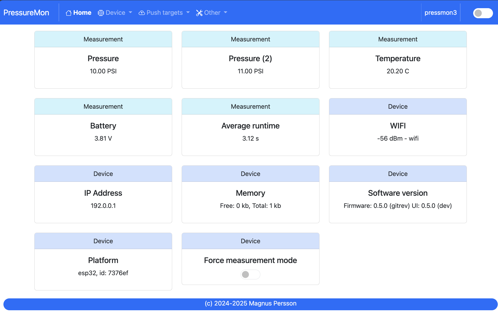
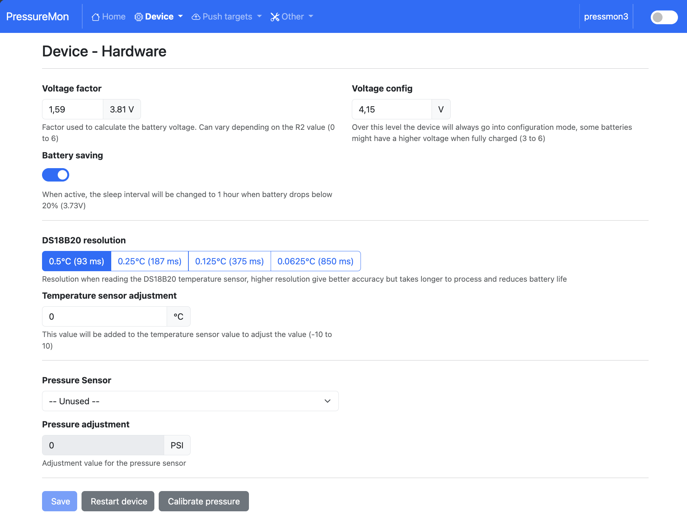
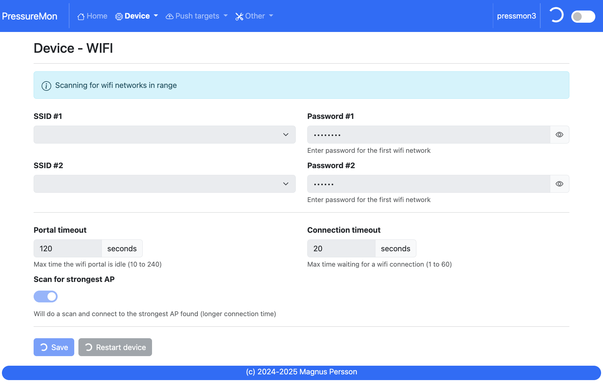
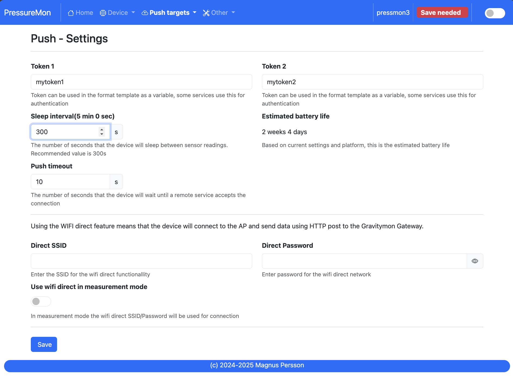
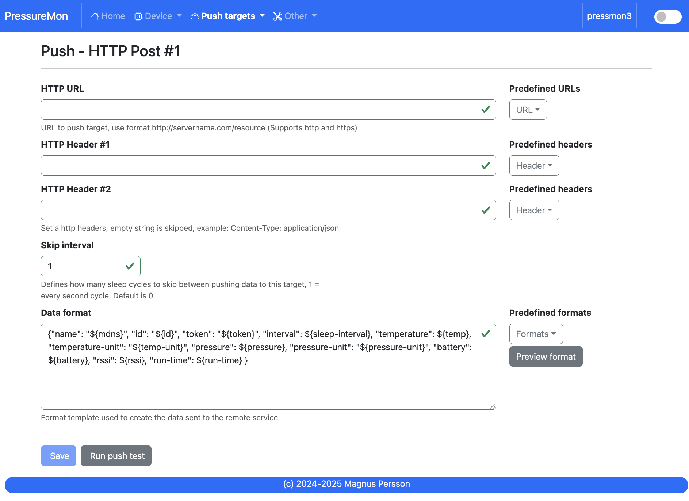
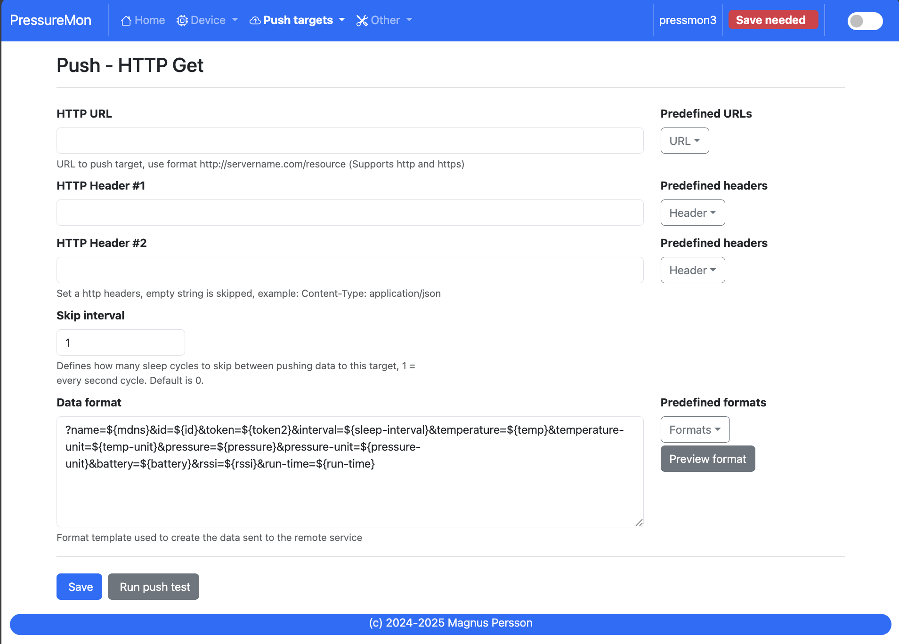
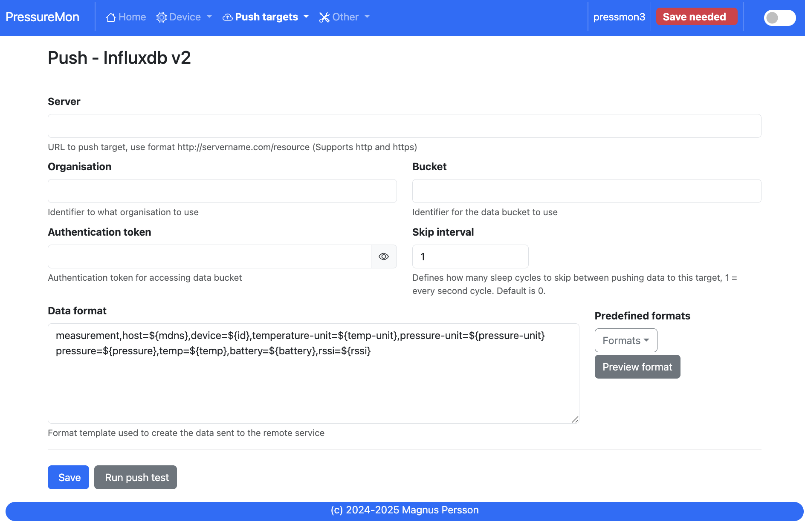
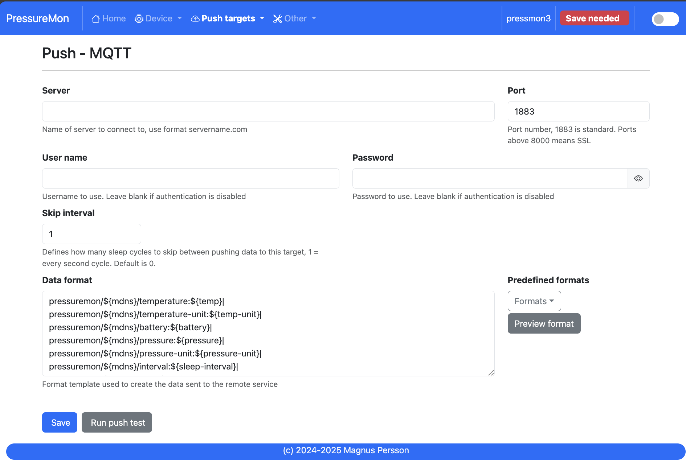
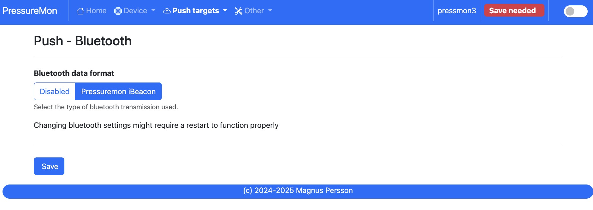

Configuration guide
===================

The web interface is available while PressureMon is in configuration mode. The
ESP status LED indicates configuration mode; the exact color or blink pattern
depends on the board. The device can enter configuration mode when sleep is
disabled from Home, no measurement sensor is enabled, the battery voltage is
outside its configured operating range, or the board's configuration pins are
connected (where supported).

Connect to the device's configured hostname (``<name>.local``) or IP address.
For initial setup, connect to its access point and open ``http://192.168.4.1``.
The setup access point password is ``password``.

Home
----

Home shows the latest pressure, temperature and battery readings, device
status and configuration alerts. Turn on the Home page **Force config mode**
switch to keep the web interface available while configuring. Turn it off to
allow the firmware to enter measurement mode and sleep between readings.

The measured connection and processing time helps explain battery use. Slow or
unreliable Wi-Fi connections can increase active time and shorten battery
life. A red indicator beside a menu item means that the page has a setting or
status that needs attention.

Device settings
---------------

* **mDNS name** sets the local hostname and device name used by integrations.
  Use letters, digits and hyphens, and keep it short for compatibility.
* **Temperature format** selects Celsius or Fahrenheit for displayed and
  transmitted values.
* **Pressure format** selects PSI, bar or kPa for display and supported
  outputs. Pressure is stored internally in PSI and converted for output.
* **Dark mode** changes the web interface appearance.
* **Factory defaults** clears saved configuration and restores defaults.
* **Restart** reboots the device.

Hardware and sensors
--------------------

* **Voltage factor** adjusts the battery measurement scaling. Compare the
  displayed voltage with a meter before changing this value.
* **Configuration voltage** sets the upper battery/charging voltage threshold
  used to keep the device awake for configuration. The supported range is
  3–6 V; set it high if charging should not trigger setup mode.
* **Battery saving** reduces the sleep frequency to about once per hour when
  battery voltage falls below approximately 3.73 V.
* **Battery type** selects LiPo or Li-ion battery voltage interpretation.

Sensors
-------

Open **Device → Sensors**. This page is separate from the hardware settings.
The number of pressure sensor selectors is determined by the firmware target.

* **DS18B20 resolution** trades temperature precision for conversion time:
  9-bit is fastest (0.5 °C); 12-bit is most precise (0.0625 °C).
* **Temperature adjustment** applies an offset from −10 to +10 degrees.
* **Pressure sensor** selects an XIDIBEI XDB401 digital I2C range from 0.2 to
  4.0 MPa. The list includes intermediate full-scale ranges; select the exact
  rating printed on the sensor.
* **Sensor 2** configures the optional second pressure sensor on boards that
  expose its bus.
* **Pressure adjustment** applies an offset independently to each sensor.
  **Calibrate pressure** averages sensor readings and sets the zero offset;
  expose the sensor to atmospheric pressure before starting calibration.
* **Custom analog sensor** reveals minimum and maximum voltage and pressure
  fields. These map the ADS1115 input voltage to the selected pressure range.
  The firmware ADC is configured for a ±2.048 V measurement range and reads
  channel A0. Its input must also remain within the ADS1115 supply rails. Check
  the sensor and board electrical limits before connecting it.

Wi-Fi
-----

Configure a primary SSID and password. An optional secondary network can be
used as a fallback. **Connect timeout** controls how long the device waits for
a network connection. **Portal timeout** controls how long the Wi-Fi setup
portal stays open. If the device cannot connect, use its setup access point to
update the credentials.

The Wi-Fi page scans for nearby networks and lets you select an SSID. Use the
manual-entry view for hidden networks. The optional strongest-access-point
switch is only shown when enabled by the firmware feature flags.

Push settings
-------------

Set the device identity and shared options here before configuring individual
push targets.

* **Token 1** is included in the default iSpindel-compatible data format used
  by HTTP targets.
* **Token 2** is available to templates and commonly used as an authorization
  token for GET integrations.
* **Sleep interval** sets the time between measurement cycles, from 10 to 3600
  seconds. A longer interval generally extends battery life. Weak Wi-Fi and
  frequent pushes can also increase power use.
* **Wi-Fi Direct SSID and password** identify the GravityMon Gateway network.
  When Wi-Fi Direct is enabled, PressureMon sends its data to the gateway and
  bypasses the separately configured push targets.
* **Push timeout** limits how long a target connection may take.
* **Estimated battery life** uses recent active time and the configured
  interval to estimate runtime; it is an estimate, not a battery test.

HTTP POST targets
-----------------

HTTP POST 1 and HTTP POST 2 each have a destination URL, up to two request
headers, a push skip interval and a data template. Use an ``https://`` URL for
TLS. Headers must use ``Name: value`` syntax, for example:

.. code-block:: text

   Content-Type: application/json
   X-Auth-Token: your-token

A skip interval of 0 sends on every measurement cycle; a value from 1 to 5
skips that many cycles for the target. The format editor accepts the built-in
formats or a custom template. Right-click the editor to see available fields.
See :doc:`format-template` for the template syntax.

HTTP GET
--------

GET sends a request to the configured URL. Configure the URL, optional
headers, skip interval and output template. Use URL query parameters or a
template supported by the service. HTTPS is selected by using an ``https://``
URL.

InfluxDB
--------

Configure the InfluxDB v2 server URL, organization, bucket, write token, skip
interval and line protocol template. The token needs write access to the
selected bucket. Use the server URL expected by your InfluxDB deployment; TLS
is available when the URL uses HTTPS.

MQTT
----

Set the broker hostname, port, optional username and password, skip interval,
topic and data template. Enter a hostname without a URL scheme. Common broker
ports are 1883 for unencrypted MQTT and 8883 for MQTT over TLS. The UI accepts
ports from 0 to 65535; use the port configured by your broker. Credentials
are optional when the broker permits anonymous access.

Bluetooth
---------

Choose **Disabled** or **PressureMon iBeacon**. BLE is available on ESP32-S3
and ESP32-C3 targets; it is not available on ESP32-S2 Mini. The UI's Eddystone
option is currently disabled in code. The firmware advertises PressureMon
sensor readings for nearby BLE receivers; use the documented PressureMon
beacon format in a compatible scanner.

Wi-Fi setup mode
----------------

When no saved network credentials are available, the device starts an access
point named ``PressureMon`` with the default password ``password``. Connect
and browse to ``http://192.168.4.1``. The network settings page can scan for
visible access points or open its manual-entry view for a hidden SSID. Saving
new Wi-Fi settings requires a restart to connect using them.

Other pages
-----------

The **Other** menu includes serial output, settings backup and restore,
firmware update, support logs, tools and About information.

* **Backup** downloads a text file containing device configuration and format
  templates. Restore accepts a previously exported ``.txt`` file. Keep a
  backup before changing many settings or reinstalling firmware.
* **Firmware update** uploads a firmware file to the running device. Choose a
  binary built for its detected board and keep the device powered until it
  restarts.
* **Support** displays device logs and includes support actions such as push
  status and hardware diagnostics.
* **Tools** lists LittleFS files and storage use. Expand advanced tools to
  upload or delete files and to manage CORS settings. These are internal
  firmware files; deleting or replacing them can affect device operation.
* **SD card files** are a conditional file-manager view in the shared UI. The
  current PressureMon firmware does not initialize or expose an SD card
  interface, so an SD slot is not part of the documented reference hardware.

The **Device → Sensors** calibration action requires a detected pressure
sensor. The **Tools** page also provides voltage-factor calibration and
hardware scans: I2C addresses are scanned on the second sensor bus and
1-Wire devices are listed when present.
