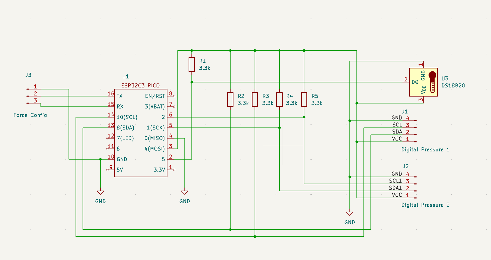
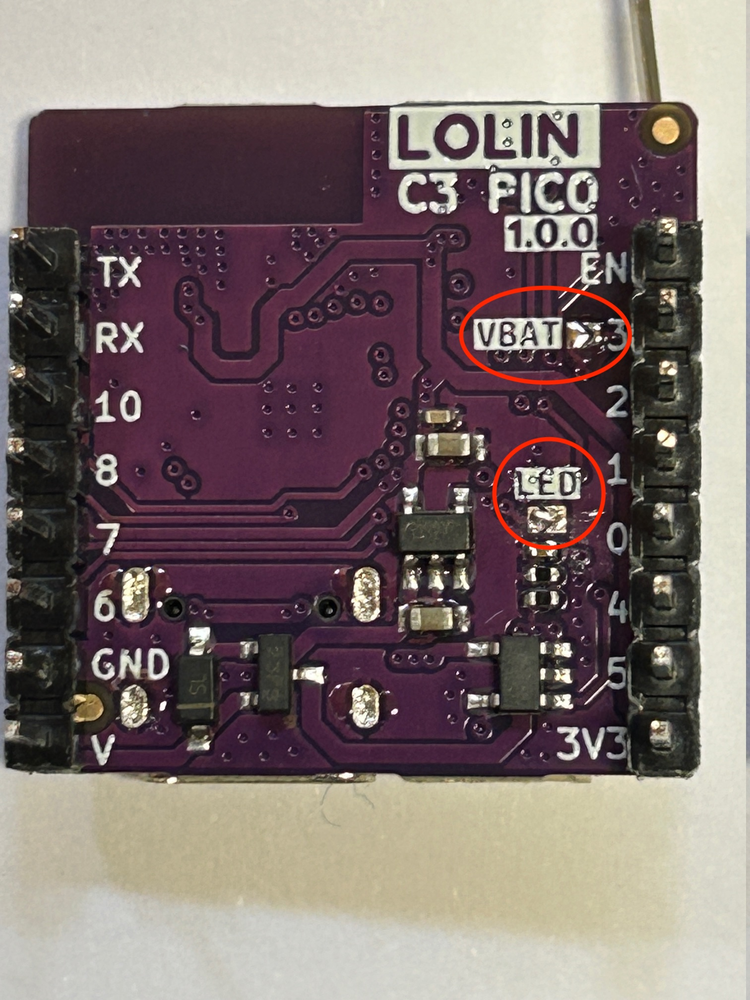
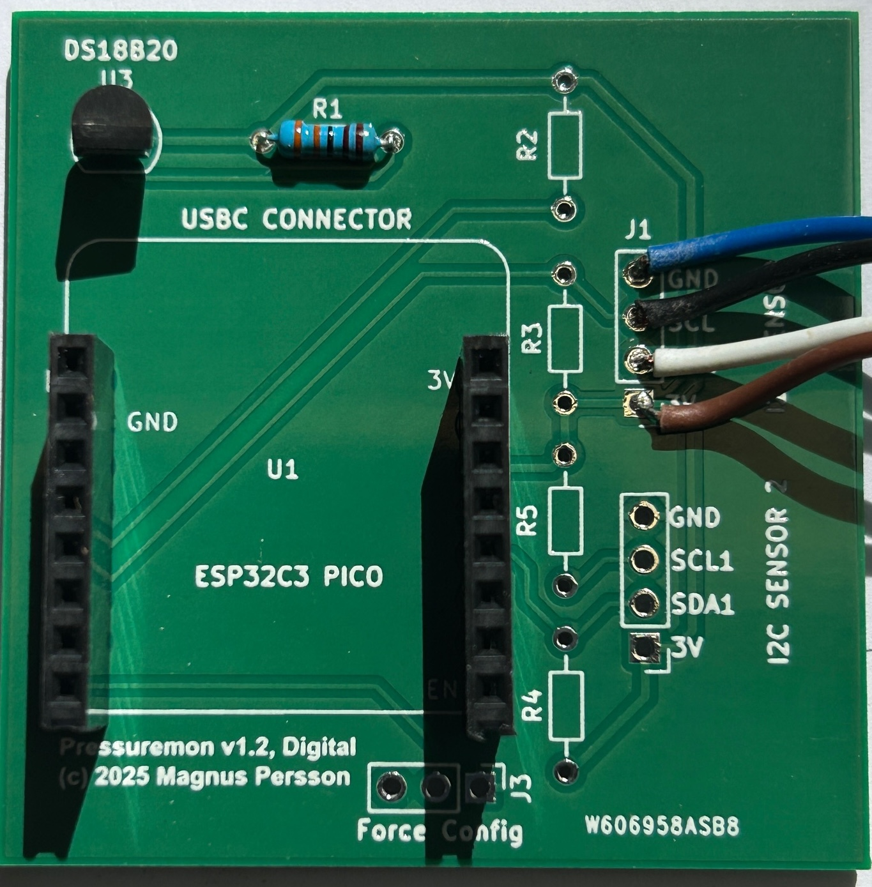

.. _hardware:

Hardware
########

Supported boards
----------------

The current source tree includes firmware environments for:

* **Lolin ESP32-C3 Pico** — BLE support, one hardware I2C bus, and software I2C
  for the optional second sensor.
* **Lolin ESP32-S2 Mini** — no BLE support; one hardware I2C bus and software
  I2C for the optional second sensor.
* **Lolin ESP32-S3 Mini** — BLE support, two hardware I2C buses, and optional
  second pressure sensor.

The project page and flasher may offer additional board variants. Match the
image to the exact hardware selected there. Do not assume a generic ESP32
board shares the PressureMon pin map or battery circuitry.

Core components
---------------

A typical build contains a supported ESP32 board, a compatible battery and
charger, a pressure sensor and fitting appropriate for the vessel, and a
DS18B20 temperature probe. The PressureMon Pico PCB includes power management
and sensor connections. Custom boards may need their own charger, battery
voltage divider, power control, and sensor interfaces.

XIDIBEI digital pressure sensors use I2C and are available in several pressure
ranges. Select a model and range suitable for the intended vessel and service
pressure. The sensor must be powered at the voltage specified for its model.
Check its fitting, seals, pressure rating, and food-contact suitability for the
installation.

Analog sensors are read through an ADS1115 external ADC. Verify the output
voltage is within the ADC input range and never exceeds the board or converter
rating. Analog support is a configurable path for compatible sensors; the
sensor's voltage-to-pressure relationship must be calibrated correctly.

I2C and temperature connections
--------------------------------

The XIDIBEI digital sensor uses the primary I2C bus. Some boards expose a
second hardware bus; on the C3 and S2 builds the optional second sensor uses a
software I2C bus and may read more slowly. The XIDIBEI modules used in the
reference design include I2C pull-ups; check the actual sensor and PCB before
adding more pull-ups.

The DS18B20 connects to the board's temperature pin and requires an appropriate
data pull-up resistor. The reference build uses 3.3 kΩ. Follow the board
schematic for power, ground, and signal orientation.

Reference board pins
--------------------

.. list-table:: Pin definitions in the current firmware
   :header-rows: 1

   * - Board
     - I2C SDA / SCL
     - Second I2C SDA / SCL
     - Battery voltage
     - DS18B20
   * - ESP32-C3 Pico
     - GPIO 8 / 10
     - GPIO 1 / 2 (software I2C)
     - GPIO 3
     - GPIO 5
   * - ESP32-S2 Mini
     - GPIO 33 / 35
     - GPIO 6 / 4 (software I2C)
     - GPIO 3
     - GPIO 12
   * - ESP32-S3 Mini
     - GPIO 35 / 36
     - GPIO 6 / 5
     - GPIO 2
     - GPIO 10

These are firmware pin definitions. Check the schematic for the particular
board revision before wiring. The ESP32-S2 build does not include BLE.

Displays and enclosures
-----------------------

The ESP32-C3 Pico reference board can support an optional 0.96-inch OLED on the
primary I2C bus. The display is most useful when the device is externally
powered because it increases power use. The project includes 3D-printable case
parts in ``3d/`` and board schematics in ``cad/``.

Reference diagrams
------------------

The assembly photos show an earlier prototype PCB. Confirm jumper and switch
locations against the schematic and board revision you are building.
